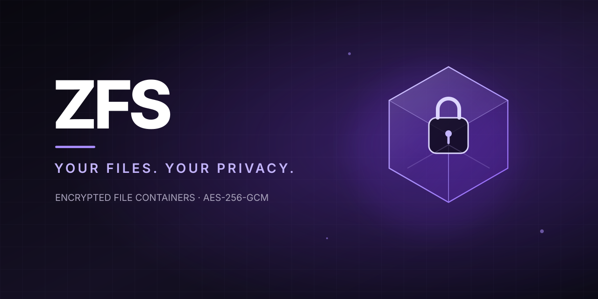

# ZFS Vault



**ZFS Vault** — Android-приложение для создания и открытия зашифрованных файлов собственного формата ZFSF.

## Возможности

- Шифрование файлов с помощью AES-256-GCM.
- Получение ключа из пароля через PBKDF2-HMAC-SHA256.
- Импорт файлов с устройства и сохранение защищённых контейнеров.
- Просмотр изображений и восстановление исходных файлов.
- Поддержка текстовых, документных, медиа- и бинарных типов.

## Расширения

| Расширение | Назначение |
|---|---|
| `.ztxt` | Текст |
| `.zdoc` | Документы и заметки |
| `.zdata` | Структурированные данные |
| `.zlog` | Журналы и логи |
| `.zimg` | Изображения |
| `.zvid` | Видео |
| `.zaud` | Аудио |
| `.zpdf` | PDF |
| `.zarc` | Архивы |
| `.zbin` | Другие бинарные файлы |

## Документы

- [Политика конфиденциальности](docs/PRIVACY_POLICY.md)
- [Спецификация формата ZFSF v1](docs/ZFS_FORMAT_V1.md)

## Структура проекта

- `zfs/` — исходный код Android-приложения.
- `docs/` — техническая документация и политика конфиденциальности.
- `.github/workflows/zfs-build.yml` — GitHub Actions для сборки APK.
- **Releases** — опубликованные релизы и готовые сборки находятся во вкладке Releases GitHub.

## Сборка

Требуются JDK 17, Android SDK 36 и Gradle 8.13.

```bash
gradle --no-daemon :zfs:assembleDebug
```

APK появится здесь:

```
zfs/build/outputs/apk/debug/zfs-debug.apk
```

## Формат и безопасность

ZFSF v1 использует 38-байтовый заголовок, PBKDF2-HMAC-SHA256 (600 000 итераций) и AES-256-GCM. Расширение файла само по себе не обеспечивает защиту: содержимое защищает шифрование.

**Важно:** ZFS — развивающийся проект и пока не проходил независимый аудит безопасности. Потеря пароля означает потерю доступа к содержимому. Храните резервные копии важных оригиналов.

## Версия

Текущая линия проекта: **ZFS Vault 0.2**.
